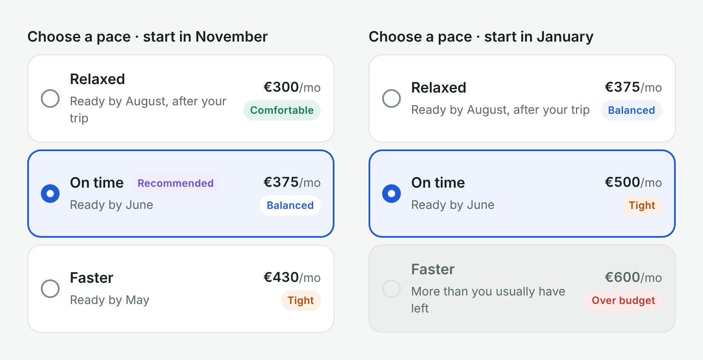

# Plan option · design-to-code

The **Plan option** component from the Holiday Fund Figma file, built in React, with its tokens, tests and a Code Connect template. It is part of a design exercise for an AI-native mobile banking journey: saving €3,000 for a summer holiday.



| File | What it is |
|---|---|
| `tokens/tokens.json` | The same values as the Figma variables (Primitives, Tokens, Dimensions) |
| `scripts/build-tokens.mjs` | Generates `src/tokens.css`. `status/warning/fg` in Figma becomes `--status-warning-fg` |
| `src/PlanOption.tsx` | `PlanOption` and `PlanOptionGroup`: native radios inside a fieldset, one selected at a time |
| `src/plan-option.css` | Styles, using only tokens |
| `src/affordability.ts` | The rule behind the badge: ≤65% comfortable, ≤80% balanced, ≤100% tight, above that over budget (and disabled) |
| `src/PlanOption.figma.ts` | Code Connect template: maps each Figma property to a code prop for Dev Mode |
| `demo/` | The component rendered with the November and January plans |

## Run it

```sh
npm install
npm run tokens          # tokens.json → src/tokens.css
npm test                # affordability and currency rules
npm run typecheck
npm run demo            # bundles demo/, then open demo/index.html
npm run connect:parse   # official Code Connect CLI, checks the template
npm run connect:preview # local run of the template with sample values
```

## Figma → code

| Figma property | Code prop |
|---|---|
| State (Default · Selected · Disabled) | `selected` comes from `PlanOptionGroup`; `disabled` |
| Title | `title` |
| Amount ("€375") | `monthlyAmount={375}`, formatted with `Intl.NumberFormat` |
| Detail | `detail` |
| Recommended | `recommended` |
| Badge › Tone (exposed nested instance) | `affordability` |

## Publishing to Dev Mode

Code Connect publishing needs a Figma **Organization or Enterprise** plan with a Full or Dev seat. On those plans:

1. In Figma, right-click the **Plan option** component set → *Copy link to selection*.
2. Paste the link into the `// url=` line of `src/PlanOption.figma.ts`.
3. Run `npx figma connect publish` with a Figma access token.

The template already passes `figma connect parse` (Code Connect 2.0.2).

## Found while coding

On the selected card, the Info badge and the card both use `blue/50`, so "Balanced" lost its shape. The code gives that badge a white background when its card is selected. The same change should be made in the Figma component.

## How it was made

Written with an AI assistant (Claude) from the Figma component spec, then reviewed. Tests, the TypeScript check and `figma connect parse` all pass.
